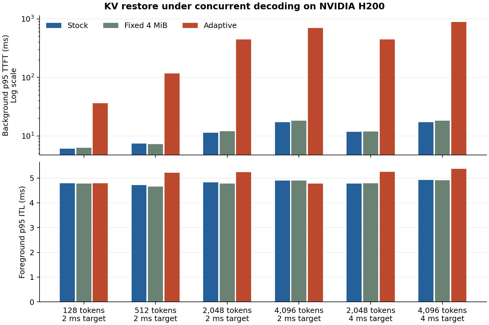

# Decode-aware KV reload on Runpod H200

The adaptive policy increased background p95 time to first token (TTFT) in all six tested settings. It also increased foreground p95 inter-token latency (ITL) in four settings. The largest improvement in foreground p95 ITL was 2.6%, with a 41× increase in background p95 TTFT in the same setting.

The run used one NVIDIA H200 SXM, driver 595.91.07, CUDA 13.2.86, llama.cpp b12250, and Qwen3-4B-Instruct-2507 Q4_K_M. All 37 model layers were offloaded. The code was KV Cache Foundry commit c91d8e24a50c4bc467effaf981e03b9b9235a9c6.

Each setting ran three trials per mode, rotating mode order. Each trial ran 12 background requests and 256 foreground decode steps in separate contexts on the same GPU. Foreground p95 values below are medians of the three trial p95s. Background p95 values are nearest-rank percentiles pooled over 36 requests per mode, including requests that started after the foreground finished. Lower is better. All times are milliseconds.

| Prefix tokens | ITL target | Foreground p95, stock / fixed / adaptive | Background p95 TTFT, stock / fixed / adaptive | Adaptive recomputes |
| ---: | ---: | --- | --- | ---: |
| 128 | 2 | 4.789 / 4.783 / 4.786 | 6.038 / 6.271 / 36.136 | 33 |
| 512 | 2 | 4.719 / 4.651 / 5.211 | 7.436 / 7.228 / 117.471 | 24 |
| 2,048 | 2 | 4.828 / 4.776 / 5.236 | 11.413 / 12.011 / 447.566 | 6 |
| 4,096 | 2 | 4.903 / 4.899 / 4.774 | 17.168 / 18.315 / 699.882 | 3 |
| 2,048 | 4 | 4.778 / 4.785 / 5.252 | 11.722 / 11.962 / 445.795 | 9 |
| 4,096 | 4 | 4.921 / 4.913 / 5.368 | 17.219 / 18.293 / 892.077 | 6 |

All 648 background requests passed the eight-token greedy output comparison against fresh prefill. Adaptive selected recompute on 81 of 216 requests and entered the pacing wait 1,798 times across the six settings. Fixed 4 MiB transfers tracked stock closely on both metrics.

Both tested ITL targets were below stock p95 in all six settings. The controller estimates when recompute can beat a paced restore using isolated prefill timings. Under concurrent decode, recompute also used GPU resources and took much longer than those estimates. At 2,048 tokens and the 2 ms target, the median TTFT across adaptive requests was 9.62 ms, while the median among the nine adaptive requests during which foreground decode made progress before first token was 397.97 ms. This difference shows why the pooled median alone would give a misleading picture.

The model's initial snapshot export logged a CUDA memory registration warning in each setting. Calibration, the forced split-restore parity check, and every measured request completed. The results describe a single GPU and model with a two-context workload and one background request in flight.

The [run directory](h200-decode-results/) contains all six raw CSVs, their logs, the build log, GPU metadata, and the model checksum. The [release archive](https://github.com/manishklach/kv-cache-foundry/releases/download/v0.2.0/h200-decode-results.tar.gz) contains the same files. Its SHA-256 is defb3ba76a44695b23b04c0fcde4fb2ecb173f258bfc995c75b42255193ba03d.
